<div align="center">

# how · ai · works

### ¿Qué pasa de verdad cuando le escribes a una IA?

Una experiencia 3D interactiva que sigue tu prompt **dentro de un modelo de lenguaje**:
tokens, vectores, atención, probabilidades… hasta que la respuesta aparece en pantalla.
Todo ocurre en el monitor de un PC, en una habitación con LEDs, mientras alguien teclea.

Desarrollado por [@rochydev](https://github.com/rochydev).

[](https://rochydev.github.io/how-ai-works/)
[](https://threejs.org)
[](https://vitejs.dev)
[](LICENSE)

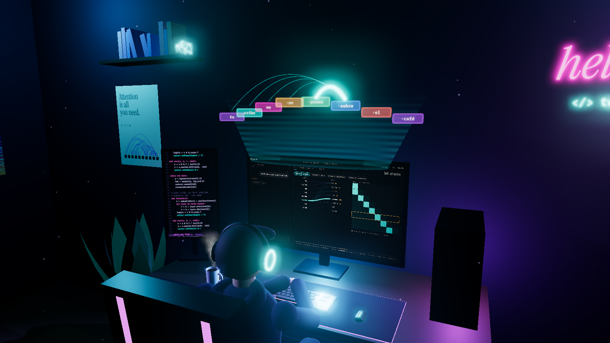

**ES** · [EN](#english)

</div>

---

## Qué es

`how-ai-works` es una visualización educativa hecha con **Three.js** que explica, paso a paso, el
recorrido completo de un prompt en un LLM (tipo GPT/Claude/Llama):

1. Escribes en el ordenador del personaje (o eliges una sugerencia) y **él teclea de verdad**: cada
   tecla que pulsas mueve su mano hasta esa tecla del teclado RGB.
2. El monitor del PC es un pequeño sistema operativo (`neural.os`) con un chat y un **inspector del modelo**
   que muestra cada etapa en tiempo real.
3. Las etapas clave saltan de la pantalla al espacio 3D como un **holograma**: los tokens flotan,
   la atención se dibuja con arcos de luz y las capas del transformer se apilan sobre el escritorio.
4. Al final la respuesta se genera **token a token**, con la temperatura que tú elijas.

> **Simulación honesta:** el tokenizador y los pesos son de juguete (no hay un modelo real detrás),
> pero **las operaciones sí son las reales**: tokenización por subpalabras, lookup de embeddings,
> codificación posicional sinusoidal, atención escalada con máscara causal, softmax con temperatura
> y muestreo autorregresivo top-k.

## El viaje de un prompt (11 etapas)

<p align="center">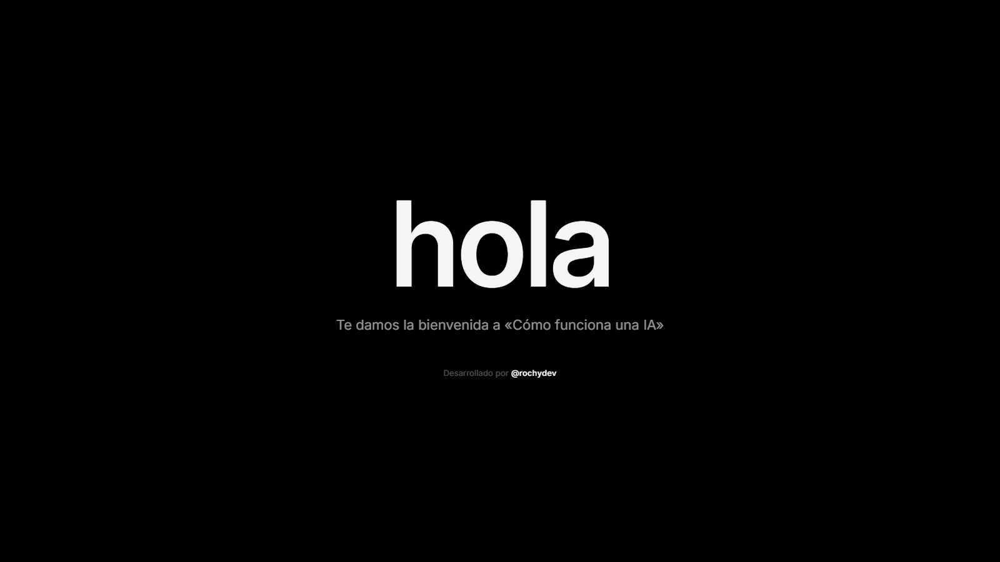<br /><sub>Al entrar: bienvenida y créditos, y la escena aparece detrás.</sub></p>

| | |
|:--:|:--:|
| 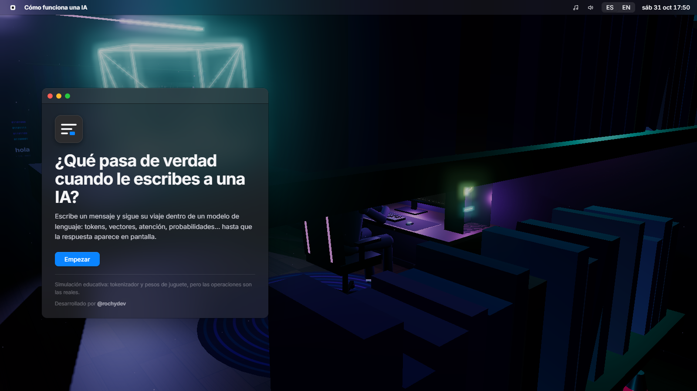 | 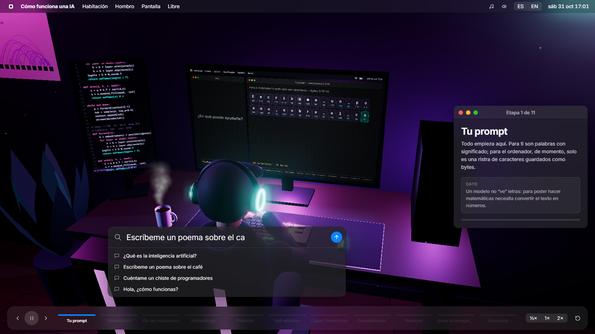 |
| **Intro** — la habitación, de noche, con lluvia en la ventana | **1 · Tu prompt** — el personaje teclea; para el PC solo son bytes |
| 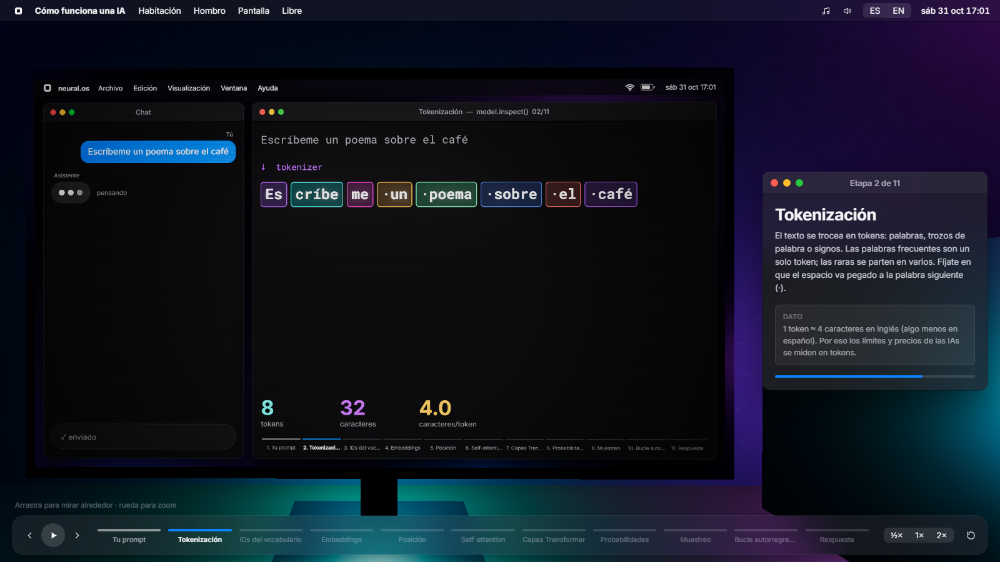 | 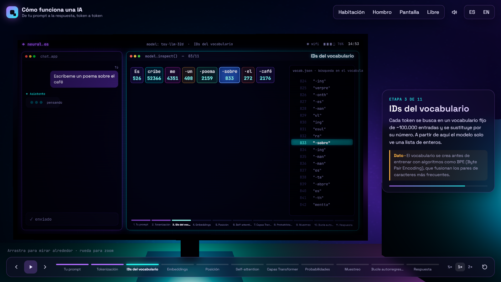 |
| **2 · Tokenización** — el texto se trocea en subpalabras (`Es·cribe·me`) | **3 · IDs** — cada token se busca en un vocabulario de ~100k entradas |
| 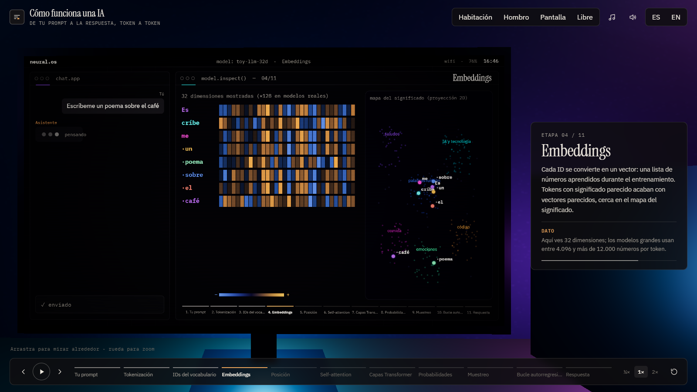 | 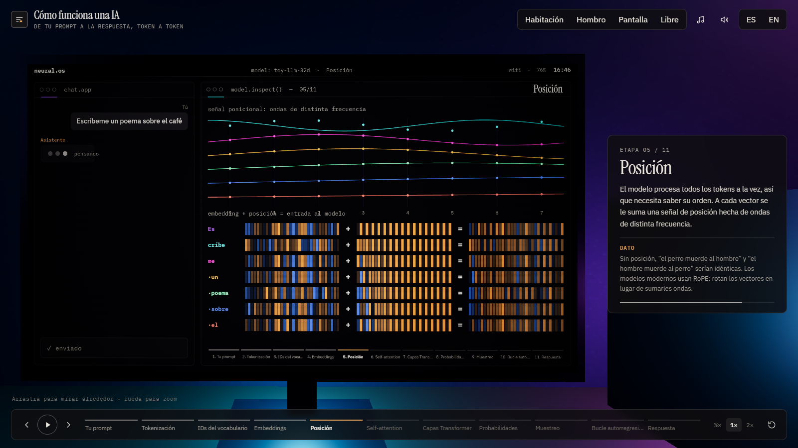 |
| **4 · Embeddings** — vectores + mapa 2D del significado | **5 · Posición** — ondas sinusoidales que codifican el orden |
| 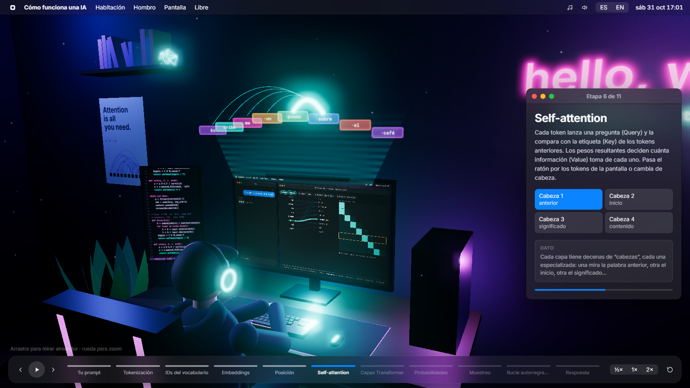 | 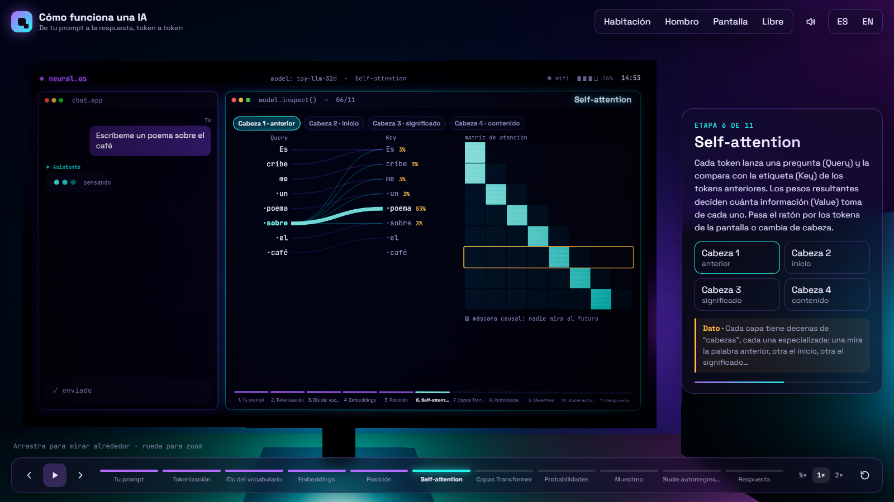 |
| **6 · Self-attention (holograma)** — arcos Query→Key en 3D | **6 · Self-attention (pantalla)** — vista tipo BertViz + matriz causal, 4 cabezas |
| 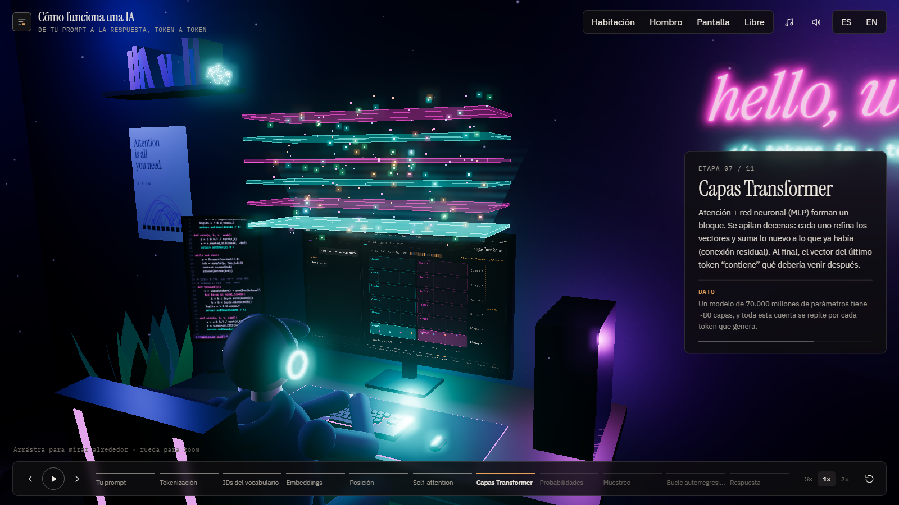 | 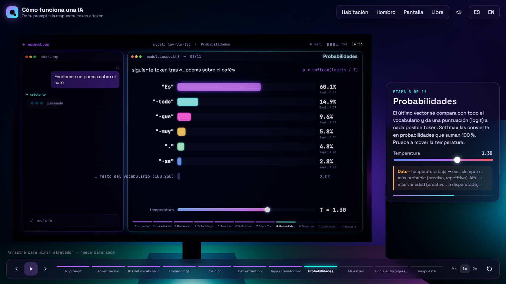 |
| **7 · Capas Transformer** — bloques Atención + MLP con conexión residual | **8 · Probabilidades** — logits → softmax, con temperatura en directo |
| 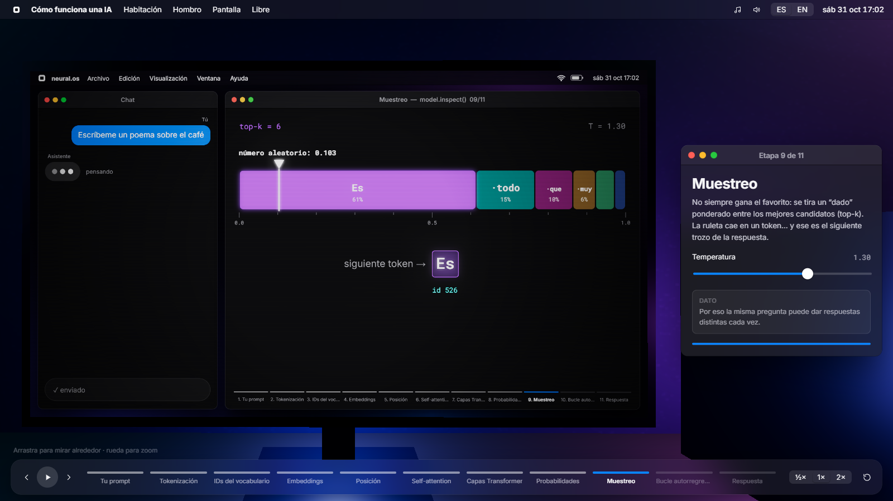 | 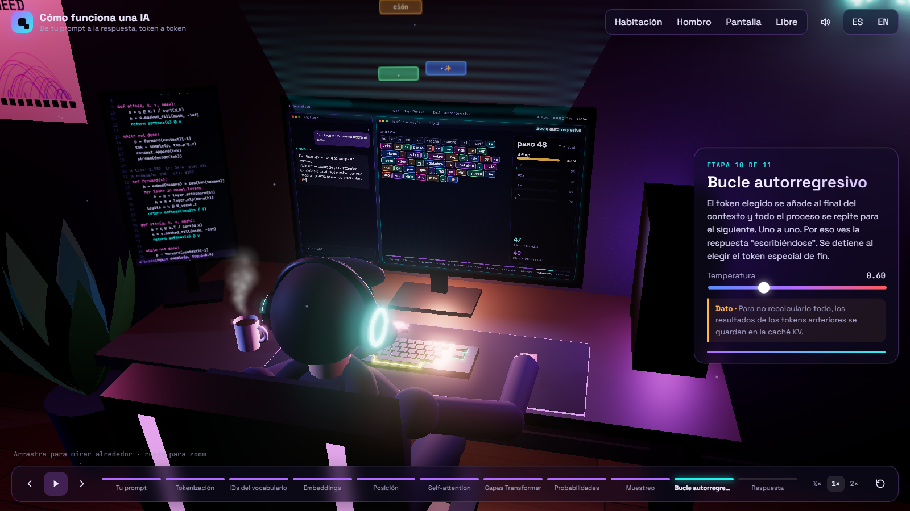 |
| **9 · Muestreo** — una ruleta ponderada elige el siguiente token | **10 · Bucle autorregresivo** — los tokens salen volando de la pantalla |
| 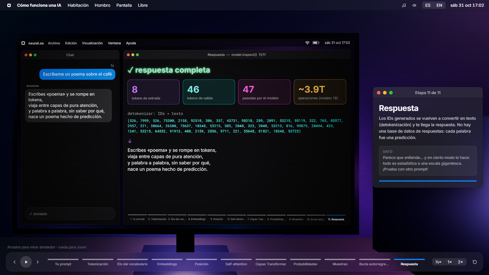 | 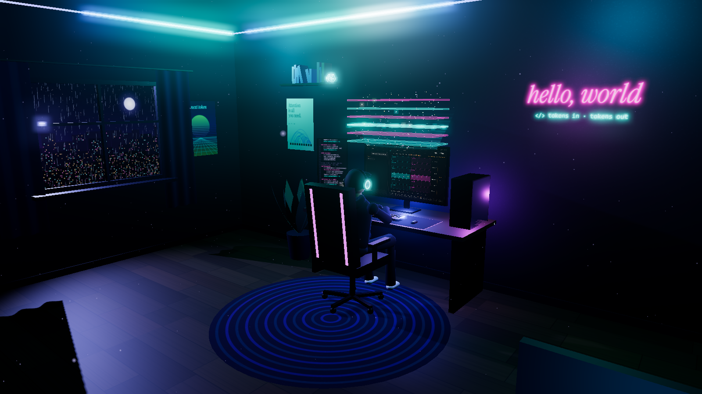 |
| **11 · Respuesta** — detokenización y estadísticas | **Vista habitación** — la escena completa con el holograma de capas |

Vídeo del recorrido completo (para redes): [`docs/video/walkthrough-es.webm`](docs/video/walkthrough-es.webm)

## Interacción

- **Escribe tu propio prompt** o usa las sugerencias (poema, chiste, código, “¿qué es la IA?”…).
- **Temperatura** en directo: a 0 el modelo es *greedy*; por encima de 1.3 empieza a desvariar
  (los tokens “equivocados” se insertan en la respuesta, como en un modelo real).
- **Cabezas de atención**: 4 cabezas con patrones clásicos (token anterior, *attention sink*,
  similitud semántica y palabras de contenido). Pasa el ratón por los tokens **del monitor 3D**.
- **Cámara**: Habitación · Hombro · Pantalla · Libre (arrastra para orbitar, rueda para zoom).
  Haz clic en el monitor para acercarte.
- **Timeline**: salta a cualquier etapa, pausa, ½× / 1× / 2×, reinicia con otro prompt.
- **Bilingüe** ES / EN.
- **Música de fondo lo-fi** generada en directo (piano eléctrico, bajo, escobillas y crujido de vinilo,
  nunca suena igual dos veces) y **sonido sintetizado** (teclas mecánicas, lluvia). Cada uno tiene su
  botón en la barra superior.
- **Responsive**: en móvil el panel pasa a la parte inferior y la cámara se reencuadra.

<p align="center">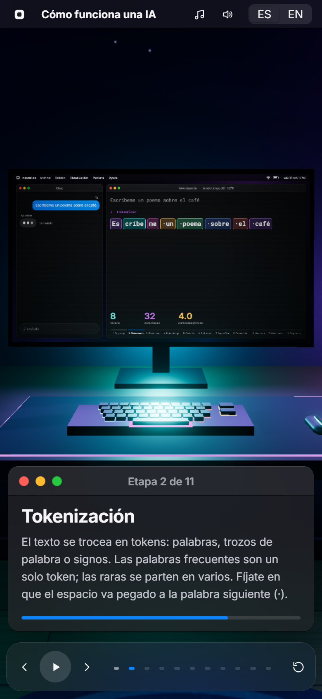</p>

## Stack y arquitectura

- **Three.js r169** (WebGL) + post-procesado `UnrealBloomPass` para el neón.
- **Vite 5**, JavaScript vanilla con módulos ES. Sin frameworks ni assets: **todo es procedural**
  (geometría, texturas en canvas, música y sonido con WebAudio).
- Interfaz al estilo **macOS**: barra de menús, ventanas con semáforos, buscador tipo Spotlight y
  línea de tiempo tipo Dock. Tipografía **SF Pro / SF Mono** en Apple, con **Inter** y **Roboto Mono**
  como alternativa en el resto de sistemas.
- **Playwright-core** solo para generar las capturas y el vídeo de la documentación.

```
src/
├── ai/            # el “modelo” de juguete
│   ├── tokenizer.js   pre-tokenizador estilo GPT + subpalabras greedy, IDs estables
│   ├── model.js       embeddings, posiciones sinusoidales, atención QKᵀ/√d causal, softmax
│   ├── pipeline.js    top-k, temperatura, muestreo autorregresivo, token de fin
│   ├── responder.js   respuestas plantilla ES/EN según la intención del prompt
│   └── stages.js      las 11 etapas: plano de cámara, LEDs, holograma, duración
├── scene/         # la habitación
│   ├── room.js        paredes, ventana con ciudad y lluvia, luz de luna con sombras
│   ├── leds.js        tiras LED (shader) con “moods” + luces reales que las siguen
│   ├── desk.js        escritorio, monitores, teclado RGB instanciado, torre con ventiladores
│   ├── character.js   personaje procedural con IK de dos huesos (brazos y piernas)
│   ├── holo.js        holograma 3D: tiles de tokens, arcos de atención, capas, chispas
│   └── props.js / particles.js / textures.js
├── screen/        # neural.os, el SO del monitor
│   ├── ScreenOS.js    canvas 1920×1080 → CanvasTexture, chat + inspector, hit-regions
│   └── views.js       una vista por etapa
├── core/
│   ├── engine.js      renderer, bloom, bucle
│   ├── director.js    planos de cámara, transiciones, parallax, órbita libre, lens shift
│   ├── experience.js  el director de orquesta: estado, autoplay, generación, picking UV
│   ├── audio.js       efectos y ambiente 100 % sintetizados
│   └── music.js       música lo-fi generativa (FM, reverb, delay, batería)
└── ui/hud.js      HUD en HTML/CSS (estilo macOS)
```

Detalles que quizá te interesen:

- **La pantalla es interactiva en 3D**: se hace *raycast* contra el monitor, se obtiene la coordenada UV
  y se traduce a píxeles del canvas, donde cada vista registra sus zonas clicables.
- **Encuadre con *lens shift***: en el plano “Pantalla” la cámara queda perpendicular al monitor y se
  desplaza el punto principal de la proyección para que el monitor quede centrado en el hueco que deja
  el HUD (sin deformar la perspectiva).
- **Las manos van a la tecla correcta**: cada carácter se mapea a una tecla del teclado instanciado y un
  IK analítico de dos huesos resuelve hombro → codo → muñeca en cada frame.
- **Continuaciones casi deterministas**: igual que en un LLM real, terminar una palabra (`predec` → `ir`)
  tiene una probabilidad altísima; la temperatura afecta sobre todo al inicio de palabras.

## Ejecutar en local

```bash
npm install
```

```bash
npm run dev
```

Abre <http://localhost:5173>. Para la build de producción:

```bash
npm run build
```

```bash
npm run preview
```

### Parámetros de URL (demos, grabaciones, capturas)

| Parámetro | Ejemplo | Efecto |
|---|---|---|
| `lang` | `?lang=en` | Idioma de la interfaz (`es` / `en`) |
| `prompt` + `stage` | `?prompt=Hola&stage=attention` | Salta directamente a una etapa con ese prompt |
| `autoplay` | `?autoplay=1` | Escribe la sugerencia nº 1 y reproduce todo el recorrido |
| `paused` | `&paused` | Empieza en pausa |
| `temp` | `&temp=1.4` | Temperatura inicial |
| `shot` | `&shot=room` | Plano inicial: `room`, `shoulder`, `screen`, `holo` |
| `ui` | `&ui=0` | Oculta el HUD (capturas limpias) |
| `splash` | `?splash=0` | Salta la pantalla de bienvenida |

### Regenerar capturas y vídeo

Con el servidor de desarrollo en marcha (usa el Edge o Chrome instalado, no descarga navegadores):

```bash
npm run capture
```

```bash
npm run capture -- --video
```

## Despliegue

El workflow [`.github/workflows/deploy.yml`](.github/workflows/deploy.yml) compila y publica en
**GitHub Pages** en cada push a `main`. Solo hay que activar *Settings → Pages → Source: GitHub Actions*.

---

<a id="english"></a>

## English

**how-ai-works** is an interactive 3D walkthrough of what happens inside a language model, from the moment
you type a prompt until the answer appears. A procedural character types on a PC in a neon-lit bedroom;
the PC's monitor runs `neural.os`, which shows every stage live, and the key stages jump out of the screen
as a hologram.

**The 11 stages:** prompt → tokenization → vocabulary IDs → embeddings → positional encoding →
self-attention (4 heads, causal mask) → transformer blocks → logits & softmax (live temperature) →
sampling → autoregressive loop → detokenized answer.

It is an **honest simulation**: the tokenizer and weights are toys, but the operations are the real ones.
Everything is procedural (geometry, canvas textures, generative lo-fi music and sound in WebAudio),
with no external assets.
Switch the UI language with the **ES / EN** toggle or `?lang=en`.

```bash
npm install
```

```bash
npm run dev
```

## Licencia / License

[MIT](LICENSE) © 2026 rochydev
